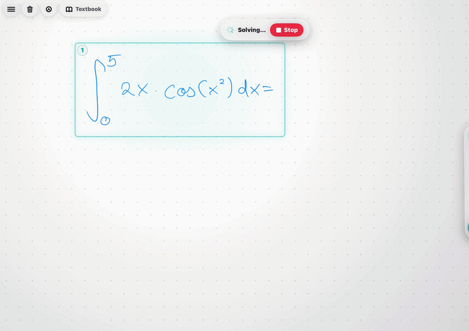

# NeuraBoard

An iPad whiteboard tutor that reads handwritten problems and writes its explanation back onto the canvas.

NeuraBoard was an existing project by Darius Farcaș and Filip Lukasiewicz. I joined them as part of a four-person hackathon team to add new features. My work focused on teacher analytics, reviewing student answers, assessment synchronization, onboarding and the Xcode build/signing setup.

<a href="assets/neuraboard-demo.gif"></a>

*An existing recording of the team's whiteboard tutor. Click to view it at full size.*

## The idea

We wanted to keep the student's work at the center of an AI tutoring session. A student writes on an iPad, asks for a hint or explanation, and sees help written beside the problem. The app can also turn an uploaded exam PDF into a practice session and show a teacher where students struggled.

The whiteboard uses PencilKit. An AI service reads a snapshot of the handwritten work and returns a structured response. A native handwriting renderer turns the answer into animated strokes on the board. Solve Mode can narrate the steps through ElevenLabs when voice is configured.

## What I worked on

The teacher side needed more detail than a single final score. I worked on the flow from a student's graded attempt to a teacher opening the result, seeing difficult questions and reviewing the answers behind the marks.

Each attempt keeps a per-question breakdown, total marks, percentage and submission time. The analytics layer calculates question averages, the class average, grade distribution and a question-by-student heatmap. Teachers can move from the overview into an individual submission.

The short performance summaries are deterministic calculations over those grades. They compare an attempt with the class average and identify low-scoring questions; they do not require another model request.

I also worked on assessment sync: publishing an exam, assigning it to a classroom, submitting a result and fetching the submissions for teacher review. Onboarding and developer-specific code signing were part of getting the team onto the same runnable app.

## How assessment data moves

```text
Teacher creates an exam and assignment
                 |
          Student takes exam
                 |
       Graded result + question marks
                 |
       Local cache / optional Supabase
                 |
      Teacher analytics and answer review
```

A local result cache keeps the single-device flow working without a backend. When Supabase is configured, the sync service mirrors exams, assignments and results through PostgREST. This was a best-effort prototype integration rather than a finished multi-device classroom service.

The analytics calculations accept the same value types whether the submissions came from the local cache or the backend. Keeping the calculations separate from network requests and SwiftUI views makes the results easier to test and reuse.

There are limits to the current data flow. The local cache retains the latest result per student and exam. Multiple-choice selections are available for same-device review but are not carried through the cross-device fetch. Older cached results without per-question grades still decode, although they cannot fill in a detailed heatmap.

## Built with

- **Swift and SwiftUI** for the native iPad application.
- **PencilKit** for handwritten input and the team's stroke-based response renderer.
- **PDFKit** for rendering uploaded exam papers.
- **OpenAI vision and text APIs** for tutoring, exam extraction and grading.
- **ElevenLabs** for optional narrated solution steps.
- **Supabase, URLSession and a local cache** for classroom and assessment data.

## Team

- **Marcin Zieliński** ([zielinskimarcin](https://github.com/zielinskimarcin)): teacher analytics, student answer review, assessment sync, onboarding and build/signing setup.
- **Filip Lukasiewicz** ([fifilukasiewicz](https://github.com/fifilukasiewicz)): native handwriting engine, whiteboard canvas and exam simulation.
- **Darius Farcaș** ([Dariusplayer09](https://github.com/Dariusplayer09)): learner guidance, AI tutor flows, Solve Mode and voice integration.
- **Lucas Pimentel** ([LucasPilla](https://github.com/LucasPilla)): exam simulation views and dashboard/classroom UI.

The team used Claude Code with an agent harness during development. My contribution was to extend the existing app during the hackathon; I did not create the original codebase.

## Prototype status

The whiteboard tutoring, exam parsing/grading and teacher analytics have working implementations. The teacher analytics calculate over submitted attempts; the student-facing personal analytics screen uses demonstration personas.

The prototype runs with a fixed demo user rather than production authentication. Learner weak-topic profiles are placeholder-backed, the subscription screen is presentational, and real-time collaboration is a placeholder. Cross-device features require backend configuration, and voice requires a configured ElevenLabs voice. Solve Mode includes canned fallback steps when a model request fails.

This repository is a project showcase with a demo and technical explanation. The team's implementation repository remains private.
